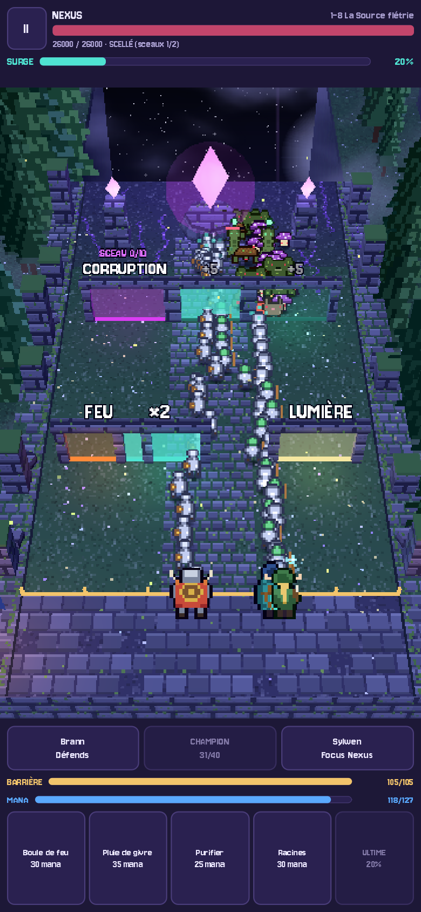

# Arcane Surge

Jeu de « foule contrôlée » en univers de fantasy magique : tu lances des flux d'invocations à travers des portails runiques pour détruire le Nexus ennemi, avec deux bots compagnons, des sorts, des classes et une histoire à choix.

- Design complet : [`docs/GDD.md`](docs/GDD.md) et [`docs/design/`](docs/design/)
- Maquettes de l'interface : [`docs/mockups/`](docs/mockups/)

## Prototype jouable (étape 9)

Version web, combat seul, 3 niveaux de la zone 1 (Bois des Lucioles) :

| Niveau | Type | Ce qu'il montre |
|---|---|---|
| 1-1 Premières lueurs | Assaut, solo | Flux, visée, portails `+5` et `×2` |
| 1-4 Les Ronces | Assaut | Portails négatifs `-5` / `÷2`, sort Purifier, ordres aux bots, tours de garde |
| 1-8 La Source flétrie | Purification | Sceaux qui protègent le Nexus, unités de Lumière, Dryades qui soignent le Nexus |

En ligne (une fois GitHub Pages activé) : **https://adamfast-tech.github.io/Arcane-Surge/**
Accès direct à un niveau : `…/Arcane-Surge/?level=z01_l08` (ajouter `&solo=1` pour jouer sans bots).

### Commandes
| Action | Tactile | PC |
|---|---|---|
| Lancer le Flux | Maintenir sur l'arène | Clic gauche maintenu (`F` : tir automatique) |
| Viser | Glisser | Souris ou `A` / `D` |
| Sort | Toucher le sort puis l'arène | `1`–`4` (lancé au curseur) |
| Champion | Bouton | `E` |
| Ultime | Bouton puis l'arène | `Espace` |
| Ordre aux bots | Toucher le bot | `Q` / `R` |
| Pause | Bouton `II` | `Échap` |



L'interface s'adapte : **portrait** sur téléphone, **paysage** (panneaux latéraux) sur tablette et ordinateur.

## Développement

Moteur : **Godot 4.7.2** (GDScript, rendu Compatibility pour le web).

```bash
godot --headless --import --path .                       # import (première fois)
godot --path .                                           # lancer le jeu
godot --headless --path . --script res://tools/sim_cli.gd -- --level=z01_l08 --runs=20   # équilibrage
godot --headless --path . --script res://tools/ui_smoke.gd                              # test des écrans
godot --headless --path . --export-release "Web" build/web/index.html                   # export web
```

| Dossier | Contenu |
|---|---|
| `scripts/battle/` | Simulation du combat (`sim.gd`, pas fixe 30 Hz, déterministe), IA des bots, rendu de l'arène, HUD |
| `scripts/battle/arena_3d.gd` | Rendu 2,5D : scène 3D pixelisée, caméra inclinée, décor de ruines, brume, lumières |
| `scripts/gfx/` | Pixel-art généré par code (atlas de sprites, textures du décor, toile de fond) |
| `data/` | Unités, sorts, Échos, groupe du joueur, niveaux (JSON, modifiables sans toucher au code) |
| `tools/` | Simulateur d'équilibrage et test de fumée (sans affichage) |

### Remplacer les sprites
Les sprites actuels sont générés par code, en attendant des sprites dessinés. Pour remplacer un personnage, déposer `assets/sprites/<nom>.png`, les 2 images d'animation côte à côte, avec un fond transparent.
- **Alliés, vus de dos** : `mage`, `brann`, `sylwen`, `familiar`, `knight`, `archer`, `golem`, `fusion`, `skeleton`.
- **Ennemis, vus de face** : `mushroom`, `rabbit`, `bear`, `pixie`, `turtle`, `wisp`, `dryad`.

## Mise en ligne (GitHub Pages)

Le workflow `.github/workflows/web.yml` importe le projet, lance les tests, exporte la version web et la publie sur GitHub Pages à chaque push sur la branche par défaut.

À faire une seule fois : **Settings → Pages → Build and deployment → Source : « GitHub Actions »**.

## Licences

Polices *Jersey 10 / 15* et *Pixelify Sans* : SIL Open Font License 1.1 (`assets/fonts/OFL-*.txt`).
