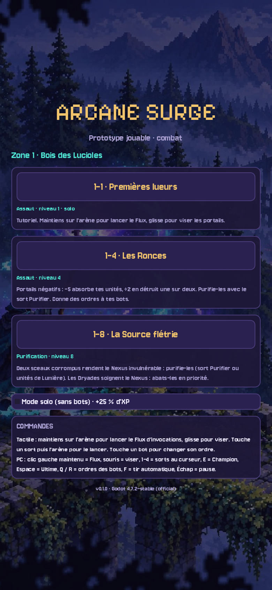
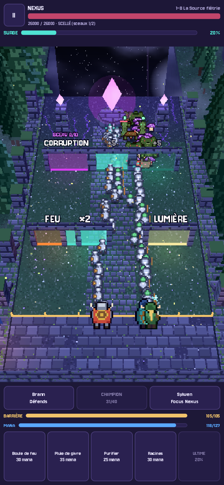
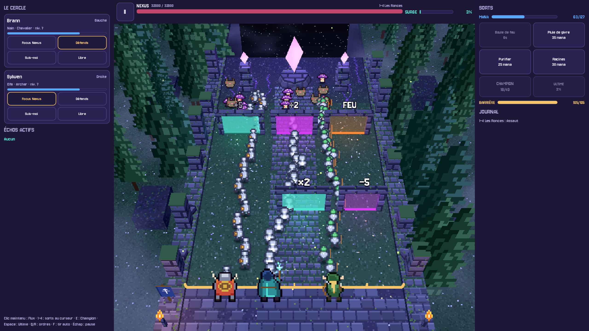

# Étape 9 — Prototype jouable (combat)

> Code : `scripts/`, données : `data/`, outils : `tools/`. Mode d'emploi : [`README.md`](../../README.md).

## 1. Contenu
- **3 niveaux** de la zone 1 : 1-1 (tutoriel solo), 1-4 (portails négatifs, bots, tours), 1-8 (Purification, sceaux, Dryades).
- **Groupe** :
  - toi : Mage elfe, niveau 8 ;
  - Brann : Nain Chevalier, défensif, sort *Bouclier levé* ;
  - Sylwen : Elfe Archère, opportuniste, sort *Tir de précision* ;
  - option solo.
- **Systèmes en place** (étape 3) :
  - Flux, portails (+N, ×N, éléments, −N, ÷N, corruption, sceaux) ;
  - éléments et effets d'état ;
  - formule de dégâts ;
  - Champion, jauge Surge et Ultime ;
  - Échos à 66 % et 33 % ;
  - soins ennemis du Nexus et anti-soin (Flétrissure) ;
  - IA par utilité des bots et ordres ;
  - Fusion arcanique au-delà de 300 unités ;
  - étoiles ;
  - aucune limite de temps.
- **Interface** (étape 8) :
  - portrait et paysage selon la fenêtre ;
  - commandes tactiles, souris et clavier ;
  - fenêtres Écho, pause et fin de partie.
- **Rendu 2,5D** (`scripts/battle/arena_3d.gd`) :
  - scène 3D rendue en basse résolution puis agrandie d'un facteur entier, ce qui donne un « pixel-art 3D » aux pixels nets ;
  - caméra inclinée à 50° derrière les lanceurs, recadrée automatiquement en portrait comme en paysage ;
  - chaussée de ruines au-dessus d'un gouffre brumeux, sapins, piliers moussus, bannière, torches, lucioles ;
  - toile de fond peinte : ciel étoilé, lune, montagnes, Tour du Croissant ;
  - clair de lune, halos sur les portails, le Nexus et les tours ;
  - unités affichées en sprites face caméra (alliés de dos, ennemis de face, 2 images d'animation), avec leurs ombres.
- **Sprites** (`scripts/gfx/sprite_atlas.gd`) : pixel-art généré par code, de 10 à 21 px de haut, en attendant des sprites dessinés. Pour en remplacer un, déposer `assets/sprites/<nom>.png` (images côte à côte).

## 2. Ajustements par rapport au design (validés par le simulateur)

| Élément | Design | Prototype | Raison |
|---|---|---|---|
| Portail `+N` | Ajoute N unités | Ajoute N unités puis **se recharge 1,5 s** | Sinon chaque unité du flux en crée N, ce qui rend le portail sans commune mesure avec ×2 |
| Portail `−N` | Retire N unités | Absorbe N unités puis **se recharge 4 s** | Symétrique de `+N` |
| Nexus | Passif | **Pulsation défensive** toutes les 2,5 s (25 × M dégâts, rayon 1,7 m) | Les Champions en siège détruisaient le Nexus trop vite |
| Champion | 30 invocations, attaque toutes les 0,6 s | **40 invocations**, attaque toutes les **1,2 s** | Même raison |
| Gain de Surge | 1 par kill, 5 par élite | **0,5** par kill, **3** par brute, porte-bouclier, lanceur, soigneur ou élite | Les vagues sont denses : l'Ultime revenait toutes les 20 s |
| PV ennemis | Valeurs de l'étape 3 | **×2** (sbire 20, brute 120…) | Pour créer de la pression sur la Barrière |
| Dryade | — | Soin du Nexus 70 × M / 2 s, en retrait près du Nexus, 3 maximum en vie | Au-delà, les soins bloquaient la partie |

## 3. Polices

Le HUD et les chiffres passent de *Pixelify Sans* à *Jersey 10 / 15* (OFL). Dans Pixelify, « 5 » et « S » sont presque identiques, et « 2 » ressemble à un S inversé : c'est illisible sur des portails « +5 » ou « ×2 ». Pixelify Sans reste pour les grands titres.

## 4. Calibrage (IA contre IA, `tools/sim_cli.gd`)

| Niveau | PV Nexus | Durée moyenne (référence) | Victoires | Barrière moyenne |
|---|---|---|---|---|
| 1-1 | 10 000 | 59 s (90 s) | 100 % | 97 % |
| 1-4 | 32 000 | 106 s (120 s) | 100 % | 94 % |
| 1-8 | 26 000 | 157 s (150 s) | 100 % | 93 % |

L'IA joue mieux qu'un débutant. Un joueur humain mettra plus longtemps et subira plus de dégâts, ce qui correspond à la cible de 2 à 4 minutes.

**Performances** : 0,15 à 0,6 ms par pas de simulation (natif), au pic d'environ 190 unités alliées.

## 5. Captures

## 6. Hors périmètre (étapes suivantes)
- Hub, équipement, arbres de compétences, compte Supabase et sauvegarde.
- Dialogues et choix narratifs ; boss de zone (Sylvarche).
- Sons et musique ; sprites dessinés à la main.
- Version native iOS / Android.
